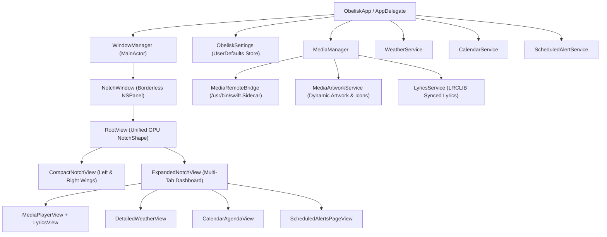

# Obelisk — Technical Architecture & Settings Documentation

This document provides a comprehensive reference for the internal architecture, subsystem pipelines, and customization settings of **Obelisk**.

---

## 1. System Architecture Overview

---

## 2. Core Window & GPU Morphing Engine

### 2.1 Physical Notch Detection (`ScreenGeometry.swift`)
- Queries `NSScreen.main?.safeAreaInsets.top` along with `auxiliaryTopLeftArea` and `auxiliaryTopRightArea`.
- Computes the exact width and height of the hardware camera housing (`185 x 32 pt` on MacBook Pro M5) so the collapsed state sits flush with the physical bezel.
- When expanded, `ExpandedNotchView` applies `topNotchClearance` (`notchSize.height + 6 + topNotchClearanceOffset`) so all interactive controls and text render completely below the physical camera cutout.

### 2.2 Zero-Lag Morphing Container (`WindowManager.swift` & `RootView.swift`)
- Calling `NSWindow.animator().setFrame(...)` during SwiftUI transitions forces macOS WindowServer to re-allocate backing stores on every frame, causing visual stutter and invalidating `NSTrackingArea` regions.
- Instead, `WindowManager.expand()` synchronously sets `NotchWindow` once to a fixed transparent canvas (`548 x 370 pt`) and animates `isExpanded` inside `RootView` using SwiftUI spring physics (`NotchShape(bottomRadius:)`).
- Upon collapse, `NotchWindow` waits until the SwiftUI spring completes before shrinking the transparent `NSPanel` frame back to `currentCompactSize`.

### 2.3 Mathematical Pointer Tracking
- While collapsed, pointer entry triggers a configurable `hoverDwellMs` timer (default `65 ms`) that verifies `NSEvent.mouseLocation` is inside the compact notch frame before expanding.
- While expanded, a `60 ms` timer (`checkExpandedCursorPosition()`) evaluates `NSEvent.mouseLocation` against the active expanded notch rectangle (`expandedSize` inset by `-12 pt`).
- Auto-collapse is suppressed while any mouse button is pressed (`NSEvent.pressedMouseButtons != 0`), allowing the user to drag the media progress scrubber outside the notch bounds without losing the panel.

---

## 3. Media Telemetry & Artwork Pipeline

### 3.1 macOS 15.4+ / Tahoe MediaRemote XPC Sidecar (`MediaRemoteBridge.swift`)
- Starting in macOS 15.4+, `mediaremoted` restricts direct in-process XPC access (`MRMediaRemoteGetNowPlayingInfo` / `MRMediaController`) to binaries signed with Apple platform entitlements.
- `MediaRemoteBridge` spawns a persistent child process using `/usr/bin/swift /tmp/obelisk_mediaremote_sidecar.swift`, which inherits Apple's platform binary signature.
- Every `0.4s` and immediately upon `kMRMediaRemoteNowPlayingInfoDidChangeNotification`, the sidecar inspects all active `MRClient` instances across Safari, Chrome, Brave, Arc, Edge, Spotify, and Apple Music:
  - Extracts `title`, `artist`, `album`, `duration`, and `playbackState`.
  - Computes real-time playback position via `calculatedPlaybackPosition` when `isPlaying && playbackRate > 0`, or `elapsedTime` when paused/buffering.
  - Writes native `artworkData` (up to `600 x 600 px` YouTube/Vidio thumbnails and album covers) to `/tmp/obelisk_art_<pid>.tiff` and streams a compact `PLAYERS_JSON:` payload over `stdout`.
- Transport commands (`PLAY`, `PAUSE`, `TOGGLE`, `NEXT`, `PREV`, `SEEK <seconds>`, `SKIP <delta>`) are sent over `stdin` to the sidecar for sub-10ms execution.

### 3.2 Post-Skip Play/Pause Synchronization (`MediaManager.swift` & `MediaPlayerView.swift`)
- When skipping forward/backward in HTML5 video players (YouTube/Vidio), WebKit temporarily drops `playbackRate` to `0.0` while buffering the new timestamp, even though `playbackState` remains `1` (`kMRPlaybackStatePlaying`).
- `MediaRemoteBridge` evaluates `pbState == 1` as authoritative for `isPlaying`, and `MediaManager` locks `effectivePlaying` for `1.2s` (`isSeekLocked`) after a manual seek or skip so the Play/Pause button never flickers.
- Dragging the progress bar in `MediaPlayerView` previews `scrubTargetSeconds` locally during `.onChanged` and dispatches `mediaManager.seek(to:)` once on `.onEnded`.

### 3.3 Dynamic Artwork & Brand Logos (`MediaArtworkService.swift`)
- Priority 1: Native `artworkData` extracted from `MediaRemoteBridge` sidecar (covers YouTube video thumbnails, Vidio stream posters, Spotify, and Apple Music covers).
- Priority 2: Official YouTube oEmbed thumbnail resolution (`https://www.youtube.com/oembed`) when a YouTube watch URL is available.
- Priority 3: iTunes Search API high-resolution (`600x600`) album cover lookup (strictly restricted to `.spotify` and `.appleMusic` so video streams never match unrelated music albums).
- Priority 4: Dynamic high-resolution platform icon resolved from installed application bundles (`NSWorkspace`) or Google Favicon CDN.

---

## 4. Weather & Calendar Subsystems

### 4.1 Live Weather (`WeatherService.swift` & `DetailedWeatherView.swift`)
- Combines `CLLocationManager` device coordinates with fast IP geolocation fallback (`ip-api.com`) and optional manual city geocoding (`geocoding-api.open-meteo.com`).
- Queries Open-Meteo (`api.open-meteo.com/v1/forecast`) with `.reloadIgnoringLocalCacheData` for current temperature, apparent temperature, relative humidity, precipitation probability, weather code, surface pressure, wind speed/direction, UV index, and 24-hour forecast aligned to the current local hour.

### 4.2 Native Calendar (`CalendarService.swift` & `CalendarAgendaView.swift`)
- Requests full calendar access via `EKEventStore.requestFullAccessToEvents()` (or `requestAccess(to: .event)`).
- Observes `.EKEventStoreChanged` notifications to update the 7-day interactive date strip and agenda list in real time whenever events are added or modified in Apple Calendar.

### 4.3 Hardware Telemetry, Universal Earbuds HUD & Audio Switcher (`HardwareTelemetryService.swift`, `AudioPeripheralsService.swift`, `SystemHubView.swift`)
- **Mach & IOKit Hardware Telemetry**:
  - Computes real-time CPU load deltas across all Apple Silicon cores via `host_processor_info(PROCESSOR_CPU_LOAD_INFO)`.
  - Computes Unified Memory usage (`active + wired + compressed` pages) via `host_statistics64(HOST_VM_INFO64)`.
  - Monitors battery capacity, charging state, and MagSafe connection events via `IOPSCopyPowerSourcesInfo` and `IOPSNotificationCreateRunLoopSource`, dispatching a transient Dynamic Island HUD (`NotchTransientHUD.battery`) when power state changes.
- **CoreAudio Output Quick Switcher & System Mic Mute**:
  - Enumerates all output streams via `kAudioHardwarePropertyDevices` and switches `kAudioHardwarePropertyDefaultOutputDevice` + `kAudioHardwarePropertyDefaultSystemOutputDevice` in real time.
  - Toggles system microphone mute via `kAudioDevicePropertyMute` and input volume scalar synchronization on `kAudioHardwarePropertyDefaultInputDevice`.
- **Universal Bluetooth Earbuds & Headphones HUD**:
  - Combines `IOBluetoothDevice.pairedDevices()`, `SPBluetoothDataType`, and CoreAudio route listeners to detect any Bluetooth earbuds or headphones (including Samsung Galaxy Buds, AirPods, Sony, and Bose).
  - Automatically displays a transient Dynamic Island HUD (`NotchTransientHUD.earbuds`) when earbuds connect or audio routes to them, and allows one-click Bluetooth Connect/Disconnect from `SystemHubView`.

### 4.4 Quick Camera Mirror & Privacy HUD (`CameraMirrorService.swift` & `CameraMirrorView.swift`)
- Uses `AVCaptureSession` and a horizontally mirrored `AVCaptureVideoPreviewLayer` (`CATransform3DMakeScale(-scale, scale, 1.0)`) to render an instant front-camera mirror below the physical notch with `1.0x Wide` and `1.3x Framing` modes.
- Automatically stops `AVCaptureSession` when closed or when the notch collapses so the hardware camera LED turns off immediately.
- Queries `CoreMediaIO` (`kCMIODevicePropertyDeviceIsRunningSomewhere`) and `CoreAudio` (`kAudioDevicePropertyDeviceIsRunningSomewhere`) to display live Camera and Microphone privacy indicators on both the compact notch wings and the expanded header bar.

### 4.5 Scheduled Alerts & Routine Alarms (`ScheduledAlertService.swift`, `ScheduledAlertsPageView.swift`, `SwingingBellIconView.swift`)
- **Timer & Persistence Engine**:
  - Manages alarms persisted in `UserDefaults` (`scheduled_alerts_list_v1`) with recurrence patterns: `Daily`, `Weekdays (Mon - Fri)`, `Weekends (Sat - Sun)`, or `One-time`.
  - Fires via a lightweight 1-second system timer that compares the current wall-clock minute against stored alert targets.
- **Standby Notch HUD & Swinging Bell Animation**:
  - Dispatches `NotchTransientHUD.scheduledAlert` to the compact notch with an animated pendulum-swinging bell glyph (`SwingingBellIconView`) on the left wing and the alert title + amber `[ OK ]` confirmation button on the right wing.
  - Keeps mouse interaction enabled while in standby alert mode so users can dismiss directly without opening the full dashboard. Auto-expand on hover is temporarily suspended to prevent accidental tab navigation during alarms.

### 4.6 Native macOS Shortcut Integration (`NotchWindow.swift`)
- Intercepts Command-key editing shortcuts (`⌘ + C`, `⌘ + V`, `⌘ + A`, `⌘ + X`, `⌘ + Z`, `⇧ + ⌘ + Z`) at the custom borderless window level (`performKeyEquivalent(with:)`).
- Dispatches standard selector actions (`copy:`, `paste:`, `selectAll:`, `cut:`, `undo:`, `redo:`) directly to the active first responder (`NSTextField` / `NSTextView`), enabling full native editing shortcuts across the application without requiring standard system menu items.

---

## 5. Comprehensive Settings Reference (`ObeliskSettings.swift` & `SettingsView.swift`)

All preferences are managed by the `@MainActor` singleton `ObeliskSettings.shared`, persisted in `UserDefaults.standard`, and reflected immediately in both the live notch and the interactive preview banner inside `SettingsView`.

### Category 1: Appearance
| Setting Property | Type | Default | Description |
| :--- | :--- | :--- | :--- |
| `surfaceStyle` | `NotchSurfaceStyle` | `.pitchBlack` | `.pitchBlack` (100% solid OLED black), `.frostedGlass` (translucent dark charcoal), or `.ambientGlow` (dynamic source-tinted aura and border). |
| `showBorder` | `Bool` | `true` | Enables or disables the hairline rim border (`UnderNotchBorder`). |
| `borderWidth` | `Double` | `0.8` | Rim border stroke thickness (`0.5 pt` to `2.0 pt`). |
| `borderOpacity` | `Double` | `0.12` | Rim border stroke opacity (`4%` to `40%`). |
| `compactCornerRadius` | `Double` | `14.0` | Bottom corner curvature when collapsed (`8 pt` to `18 pt`). |
| `expandedCornerRadius` | `Double` | `18.0` | Bottom corner curvature when expanded (`12 pt` to `26 pt`). |
| `expandedWidthPreset` | `ExpandedWidthPreset` | `.standard` | `.compact` (`440 pt`), `.standard` (`480 pt`), or `.wide` (`512 pt`). |
| `topNotchClearanceOffset` | `Double` | `0.0` | Fine-tunes vertical clearance below the physical MacBook Pro notch (`-4 pt` to `+10 pt`). |
| `compactWingMode` | `CompactWingMode` | `.dynamicAuto` | `.dynamicAuto` (widens when media active), `.alwaysMinimal` (locked to hardware notch width), or `.alwaysWide` (persistent wings). |
| `leftWingContent` | `LeftWingContentMode` | `.artworkOrLogo` | `.artworkOrLogo`, `.sourceLogoOnly`, `.weatherMini`, or `.hidden`. |
| `rightWingStyle` | `RightWingStyle` | `.equalizerBars` | `.equalizerBars` (4-bar spectrum), `.sineWave` (fluid harmonic curve), `.minimalDots` (3 pulsing dots), `.elapsedTimer` (`mm:ss`), or `.hidden`. |
| `waveformColorMode` | `WaveformColorMode` | `.platformAccent` | `.platformAccent` (Spotify green, YouTube red, Vidio crimson, Apple Music pink) or `.monochromeWhite`. |

### Category 2: Behavior & Gestures
| Setting Property | Type | Default | Description |
| :--- | :--- | :--- | :--- |
| `triggerMode` | `NotchTriggerMode` | `.hoverAndClick` | `.hoverAndClick`, `.hoverOnly`, or `.clickOnly`. |
| `hoverDwellMs` | `Double` | `65.0` | Pointer hover dwell delay before expanding (`0 ms` to `250 ms`). |
| `exitGraceMs` | `Double` | `180.0` | Time pointer must remain outside the expanded notch before auto-collapsing (`100 ms` to `450 ms`). |
| `animationSpeed` | `AnimationSpeedPreset` | `.balanced` | Spring physics preset: `.snappy` (`0.26s`), `.balanced` (`0.34s`), or `.fluid` (`0.44s`). |
| `enableHorizontalSwipe` | `Bool` | `true` | Enables two-finger trackpad horizontal scrolling and drag to switch tabs. |
| `invertHorizontalSwipe` | `Bool` | `false` | Reverses horizontal swipe page navigation direction. |
| `enableVerticalSwipe` | `Bool` | `true` | Enables two-finger vertical swiping in the Weather tab to toggle detailed metrics. |

### Category 3: Modules & Tabs
| Setting Property | Type | Default | Description |
| :--- | :--- | :--- | :--- |
| `enableMediaTab` | `Bool` | `true` | Shows or hides the Media Player module in the dashboard. |
| `enableWeatherTab` | `Bool` | `true` | Shows or hides the Weather module in the dashboard. |
| `enableCalendarTab` | `Bool` | `true` | Shows or hides the Calendar module in the dashboard. |
| `enableAlertTab` | `Bool` | `true` | Shows or hides the Scheduled Alerts & Alarms module in the dashboard. |
| `scheduledAlertDismissMinutes` | `Int` | `5` | Standby alert HUD timeout duration (1, 2, 3, 5, 10 minutes, or 0 for unlimited until dismissed). |
| `scheduledAlertRequireOK` | `Bool` | `true` | Requires clicking the amber `[ OK ]` button on the notch before the alert can be dismissed. |
| `defaultOpeningTab` | `DefaultOpeningTab` | `.lastUsed` | `.lastUsed`, `.alwaysMedia`, `.alwaysWeather`, `.alwaysCalendar`, `.alwaysAlert`, or `.alwaysNotification`. |

### Category 4: Media & Lyrics
| Setting Property | Type | Default | Description |
| :--- | :--- | :--- | :--- |
| `skipIntervalSeconds` | `Int` | `15` | Video forward/backward skip step for YouTube and Vidio (`5`, `10`, `15`, or `30` seconds). |
| `showLyricsInNotch` | `Bool` | `true` | Enables real-time synchronized lyrics below the media player. |
| `showLyricsButton` | `Bool` | `true` | Shows the `Lyrics` toggle pill in the expanded notch header. |
| `autoExpandLyrics` | `Bool` | `false` | Automatically expands the multi-line karaoke view when opening the Media tab. |
| `lyricsFontSizeScale` | `LyricsFontSizeScale` | `.standard` | Scales synchronized lyric typography (`.small`, `.standard`, `.large`). |

### Category 5: Weather
| Setting Property | Type | Default | Description |
| :--- | :--- | :--- | :--- |
| `temperatureUnit` | `TemperatureUnit` | `.celsius` | `.celsius` (`°C`) or `.fahrenheit` (`°F`). |
| `windSpeedUnit` | `WindSpeedUnit` | `.kmh` | `.kmh` (`km/h`), `.mph` (`mph`), or `.ms` (`m/s`). |
| `weatherLocationMode` | `WeatherLocationMode` | `.deviceGPS` | `.deviceGPS` (automatic CoreLocation + IP) or `.manualCity` (custom city override). |
| `manualCityName` | `String` | `"South Tangerang"` | Custom city name geocoded via Open-Meteo when `weatherLocationMode == .manualCity`. |
| `weatherRefreshMinutes` | `Int` | `1` | Background weather telemetry polling interval (`1`, `5`, `15`, or `30` minutes). |

### Category 6: System
| Setting Property | Type | Default | Description |
| :--- | :--- | :--- | :--- |
| `launchAtLogin` | `Bool` | `false` | Registers or unregisters `Obelisk.app` as a macOS login item via `SMAppService.mainApp`. |
| `showMenuBarIcon` | `Bool` | `true` | Dynamically adds or removes the `NSStatusItem` shield icon in the macOS menu bar. |
